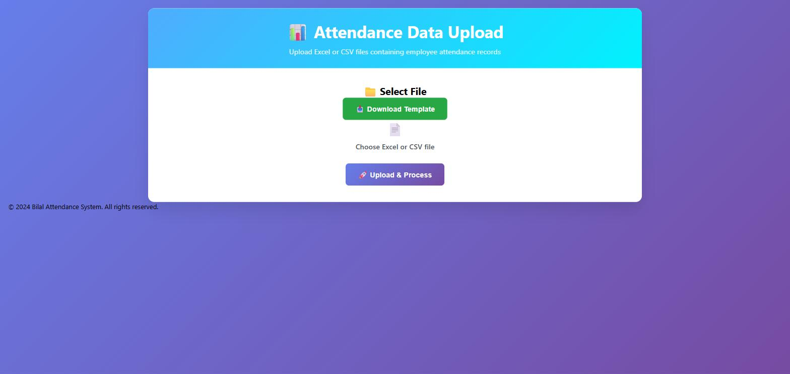

# Bilal Attendance System

A FastAPI service for uploading employee attendance logs (Excel/CSV, exported from
biometric attendance devices) with validation and PostgreSQL persistence.



## Features

- Drag-and-drop web UI for uploading `.xlsx`, `.xls`, or `.csv` attendance files
- Robust CSV parsing: auto-detects encoding (UTF-8/UTF-16/Latin-1) and delimiter
- Per-row validation with detailed error reporting (bad dates, missing fields, etc.)
- Downloadable Excel template with the expected column layout
- Attendance records and upload batches persisted to PostgreSQL via SQLAlchemy
- REST API for querying stored records and batches, with optional API-key auth
- Health check endpoints for the app and the database

## Tech stack

FastAPI · SQLAlchemy 2.x · PostgreSQL · pandas · Jinja2 · pytest

## Getting started

### Option A: Docker Compose (recommended)

```bash
cp .env.example .env
# edit .env and set DB_PASSWORD
docker compose up --build
```

The app will be available at http://localhost:8000. Tables are created
automatically on startup.

### Option B: Local Python environment

Requires Python 3.11+ and a running PostgreSQL instance.

```bash
python -m venv venv
venv\Scripts\activate        # Windows
# source venv/bin/activate   # macOS/Linux

pip install -r requirements.txt
cp .env.example .env
# edit .env with your local PostgreSQL credentials

python main.py
```

The app starts on http://localhost:8000 and creates its tables automatically
on the first successful database connection.

## Configuration

All configuration is via environment variables (see `.env.example`):

| Variable            | Description                                             | Default          |
|---------------------|----------------------------------------------------------|-------------------|
| `DB_HOST`           | PostgreSQL host                                          | `localhost`       |
| `DB_PORT`           | PostgreSQL port                                          | `5432`            |
| `DB_NAME`           | Database name                                            | `attendanceapp`   |
| `DB_USER`           | Database user                                            | `postgres`        |
| `DB_PASSWORD`       | Database password (**required**, no default)             | —                 |
| `ECHO_SQL`          | Log every SQL statement                                  | `False`           |
| `API_KEY`           | If set, required as `X-API-Key` header on protected routes | unset (no auth) |
| `AUTO_CREATE_TABLES`| Create tables on startup if missing                       | `True`            |

## API overview

| Method | Path                              | Description                          | Auth |
|--------|-----------------------------------|---------------------------------------|------|
| GET    | `/`                                | Upload web UI                         | —    |
| GET    | `/health`                          | App + database health check           | —    |
| POST   | `/upload/attendance`               | Upload and process an attendance file | API key |
| GET    | `/upload/template`                 | Download the Excel template           | —    |
| GET    | `/api/database/attendance/records` | List attendance records (paginated)   | API key |
| GET    | `/api/database/batches`            | List upload batches (paginated)       | API key |
| GET    | `/api/database/health`             | Database connectivity check           | API key |

Interactive API docs are available at `/docs` (Swagger UI) once the app is running.

## Uploading attendance files

Uploaded files must contain these columns: `No, DN, UID, Name, Status, Action,
APB, JobCode, DateTime`. Download `/upload/template` for a ready-to-fill example.

## Running tests

```bash
pip install -r requirements-dev.txt
pytest -v
```

Tests cover file parsing/validation logic and the API layer; they do not require
a live database (database-backed endpoints are exercised with a throwaway
connection and fail gracefully in CI).

## Project structure

```
config/      # DB connection, settings, and API-key auth
models/      # Pydantic (API) and SQLAlchemy (DB) models
routes/      # FastAPI routers (upload, database)
services/    # File parsing and database business logic
scripts/     # One-off setup scripts (create_tables.py, setup_database.ps1)
static/      # CSS/JS for the upload page
templates/   # Jinja2 templates
tests/       # pytest suite
```

## License

MIT — see [LICENSE](LICENSE).
